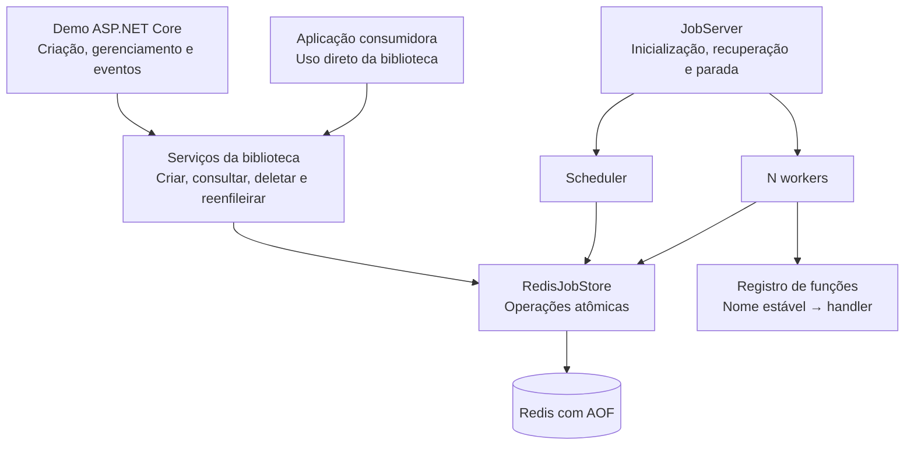

# Arquitetura do BackgroundJobs

[Início](../README.md)

## Escopo e referências

Este documento registra a arquitetura baseada na [especificação funcional](spec-base.md), descrevendo os componentes e as garantias disponíveis.

A solução usa .NET 10, ASP.NET Core com Minimal APIs e Redis com persistência AOF. Estão implementados registro tipado, criação e consulta, reserva e conclusão atômicas e execução imediata com quantidade configurável de workers, padrão 4. `JobServer` oferece inicialização, disponibilidade e parada; `JobServerHostedService` o integra ao host. A demo executa os três jobs da spec e expõe criação, listagem, detalhe, deleção, reenfileiramento, eventos e health. Agendamentos e retries são promovidos e executados pela biblioteca. Gerenciamento preserva os históricos entre ciclos; recuperação após queda fecha tentativas interrompidas antes da prontidão.

A solução contém o núcleo com motor próprio, uma extensão opcional de dashboard e uma aplicação demonstrativa. A biblioteca executa as funções dentro do processo da aplicação consumidora; Redis é o serviço externo de armazenamento.

## Visão geral

A arquitetura separa três responsabilidades:

- **Aplicação consumidora:** registra funções e solicita jobs, diretamente pela biblioteca ou por HTTP na demo.
- **Biblioteca:** persiste pedidos, controla estados e tentativas, agenda, executa, recupera e oferece operações de gerenciamento.
- **Redis:** mantém os dados persistentes e executa as operações atômicas necessárias à consistência.



Há um único processo executor por armazenamento, conforme a spec. Não é necessário implementar eleição de líder, leases distribuídos ou coordenação entre servidores.

## Organização da solução

Há duas bibliotecas, uma aplicação consumidora e três projetos de testes. A organização por pastas separa responsabilidades sem exigir um assembly para cada camada. O scheduler e a recuperação integram `JobServer`.

```text
src/
  BackgroundJobs/
    Public/           # Contratos, contexto, opções e registro de funções
    Internal/         # Preparação e contratos internos do armazenamento
    Processing/       # JobServer e loops de execução coordenados
    Storage/
      Redis/          # Persistência e scripts Lua
    Hosting/          # Integração com DI e IHostedService

  BackgroundJobs.Dashboard/       # Extensão opcional, componentes e assets

  BackgroundJobs.Demo/
    Endpoints/        # Contratos HTTP e tradução de erros
    Jobs/             # As três funções da demo
    Events/           # Eventos observáveis em memória
    Program.cs

tests/
  BackgroundJobs.UnitTests/
  BackgroundJobs.IntegrationTests/
  BackgroundJobs.HttpTests/
```

### Dependências

- .NET 10 como plataforma da biblioteca e da demo.
- ASP.NET Core Minimal APIs para HTTP.
- `System.Text.Json` para argumentos e contratos JSON.
- `StackExchange.Redis` para comunicação com Redis.
- Abstrações de hosting, injeção de dependências e logging de `Microsoft.Extensions`.
- `TimeProvider` para abstrair o relógio nos componentes que dependem de tempo.

O motor de processamento, agendamento e retry é implementado no projeto. Bibliotecas prontas de processamento de jobs não assumem essas funções.

### Limites de responsabilidade

A biblioteca não depende de ASP.NET Core. Os endpoints ficam na demo e chamam serviços públicos da biblioteca.

A demo valida os parâmetros específicos das suas funções no contrato HTTP. O registro de cada função também fornece à biblioteca a validação dos seus argumentos, aplicada na criação e novamente antes da execução, inclusive no uso sem HTTP. A biblioteca valida suas próprias opções, nomes registrados e operações de estado. Nenhum endpoint implementa processamento, espera de agendamento ou retry.

<a id="33-extensão-opcional-de-monitoramento"></a>

### Extensão opcional de monitoramento

O pacote `BackgroundJobs.Dashboard` disponibiliza a interface Blazor na aplicação ASP.NET Core consumidora com um registro de serviços. Reutiliza a conexão Redis e as operações públicas de gerenciamento; não cria um executor. Instalação, consultas, autorização, atualização e limites estão em [dashboard](dashboard.md).

## Componentes

| Componente | Responsabilidade |
| --- | --- |
| `IJobClient` | Enfileirar ou agendar e devolver o ID somente após persistir. |
| `IJobManager` | Consultar, listar, deletar e reenfileirar. |
| `JobRegistry` | Compor os catálogos compartilhados `Contracts` e `Handlers`, com registro conjunto sem acréscimos parciais em caso de configuração inválida. |
| `JobContracts` | Associar nomes estáveis a tipos de argumentos, serialização, desserialização e validação opcional. Não exige handler. |
| `JobHandlers` | Associar contratos conhecidos a handlers com o mesmo tipo de argumentos. |
| `JobContext` | Fornecer `JobId` e `Attempt`, começando em 1. |
| `JobServer` | Coordenar inicialização, recuperação, processamento e parada. |
| `Scheduler` | Promover jobs elegíveis de `scheduled` para `enqueued`. |
| `Worker` | Assumir um job, invocar sua função e persistir o resultado. |
| `IJobStore` | Definir operações persistentes com semântica de domínio. |
| `RedisJobStore` | Implementar o armazenamento e as operações atômicas. |

## Decisões e limites

| Decisão | Justificativa |
| --- | --- |
| .NET 10 e Redis com AOF | Executar as funções no processo consumidor e manter pedidos, estados e históricos persistentes. |
| Motor dentro da biblioteca | Manter a responsabilidade exigida pela spec e permitir uso sem HTTP. |
| Descritor com nome e argumentos JSON | Reconstruir a chamada pelo registro da aplicação, sem persistir código ou serviços. |
| Novo identificador para mudança incompatível | Preservar o contrato de jobs aceitos antes de uma atualização. |
| Validação na criação e execução | Detectar argumentos inválidos sem depender apenas da desserialização. |
| Manutenção de contratos antigos | Permitir agendamento, retry, recuperação e reenfileiramento de registros existentes. |
| Migração apenas explícita | Evitar conversões silenciosas e preservar rastreabilidade de mudanças nos dados. |
| Núcleo, dashboard opcional e demo separados | Permitir consumo sem HTTP ou UI e distribuir o monitoramento em um pacote próprio. |
| Scripts atômicos | Preservar consistência entre estado, tentativa, histórico e índices. |
| Polling curto | Simplificar agendamento e descoberta de trabalho, com validação da meta de latência. |
| Sequência crescente na fila | Garantir FIFO sem ambiguidade de timestamps iguais. |
| Ciclos e tokens internos | Preservar numeração pública e reconhecer confirmações repetidas. |
| Nenhuma reserva antecipada | Simplificar gerenciamento e parada, mantendo pendentes no armazenamento. |

Permanecem fora do escopo da biblioteca múltiplas filas, prioridades, recorrência, dependências, exclusão por chave, hooks públicos, timeout de jobs, cancelamento em execução, retenção automática e autenticação. A interface gráfica está disponível como extensão opcional, além da entrega obrigatória da spec.

Os critérios de aceite e contratos HTTP estão verificados conforme a síntese em [testes e validação](testes-e-validacao.md). As informações do estudo têm responsabilidade definida no [plano de desenvolvimento](plano-desenvolvimento.md#5-definição-de-pronto-do-projeto).

## Documentação técnica por assunto

| Documento | Conteúdo |
| --- | --- |
| [Uso da biblioteca](uso-biblioteca.md) | API pública, composição e exemplo completo sem HTTP. |
| [Contratos e versionamento](contratos-e-versionamento.md) | Descritor, serialização, validação e compatibilidade. |
| [Processamento](processamento.md) | Estados, workers, agendamento, retry, recuperação e parada. |
| [Persistência Redis](persistencia-redis.md) | Modelo, índices, atomicidade e durabilidade. |
| [API HTTP](api-http.md) | Contratos, composição e jobs da demo. |
| [Dashboard](dashboard.md) | Integração, consultas, consistência e limites do painel. |
| [Testes e validação](testes-e-validacao.md) | Cobertura, reprodução e evidências. |
| [Execução local](execucao-local.md) | Ambiente, configuração e execução da aplicação. |
| [Build e pacotes](build-e-pacotes.md) | Empacotamento, consumo externo e publicação. |
