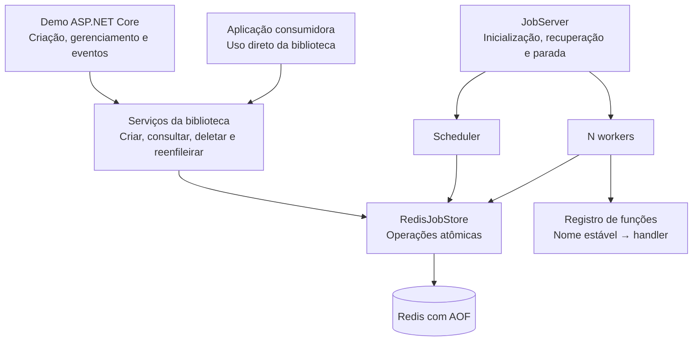
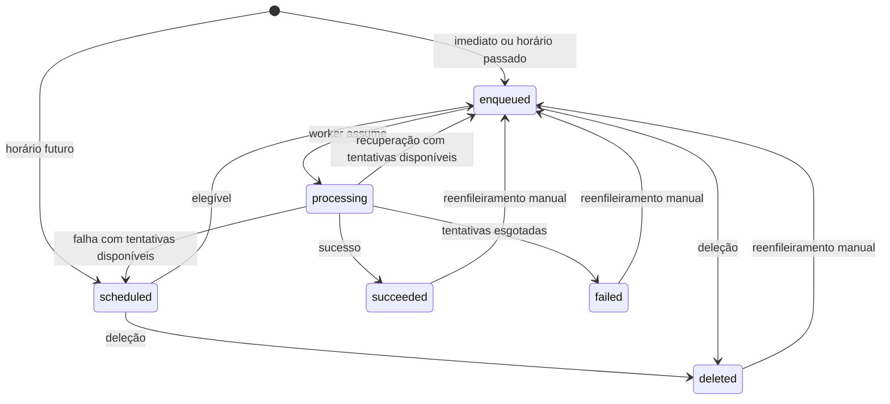

# Arquitetura do BackgroundJobs

## 1. Status e referências

Este documento registra a arquitetura baseada na [especificação funcional](spec-base.md), distinguindo o código disponível dos componentes planejados.

A solução usa .NET 10, ASP.NET Core com Minimal APIs e Redis com persistência AOF. Estão implementados o registro de contratos e handlers, os modelos públicos e a preparação interna com serialização, validação e relógio injetável. A demo cadastra o contrato `log-message`. A criação e a consulta de detalhe integradas ao Redis estão disponíveis. HTTP e motor permanecem planejados.

A entrega prevista é uma biblioteca com motor próprio de processamento e uma aplicação demonstrativa. A biblioteca executa as funções dentro do processo da aplicação consumidora; Redis é o serviço externo de armazenamento.

## 2. Visão geral

A arquitetura separa três responsabilidades:

- **Aplicação consumidora:** registra funções e solicita jobs, diretamente pela biblioteca ou por HTTP na demo.
- **Biblioteca:** persiste pedidos, controla estados e tentativas, agenda, executa, recupera e oferece operações de gerenciamento.
- **Redis:** mantém os dados persistentes e executa as operações atômicas necessárias à consistência.



Há um único processo executor por armazenamento, conforme a spec. Não é necessário implementar eleição de líder, leases distribuídos ou coordenação entre servidores.

## 3. Organização da solução

Manter os dois projetos existentes e adicionar projetos de testes. A separação inicial acontece por pastas e interfaces, sem exigir um assembly para cada camada.

```text
src/
  BackgroundJobs/
    Public/           # Contratos, contexto, opções e registro de funções
    Domain/           # Estados, tentativas e regras de transição
    Processing/       # JobServer, scheduler, workers e recuperação
    Storage/
      Redis/          # Persistência e scripts Lua
    Hosting/          # Integração com DI e IHostedService

  BackgroundJobs.Demo/
    Endpoints/        # Contratos HTTP e tradução de erros
    Jobs/             # As três funções da demo
    Events/           # Eventos observáveis em memória
    Program.cs

tests/
  BackgroundJobs.UnitTests/
  BackgroundJobs.IntegrationTests/
  BackgroundJobs.AcceptanceTests/
```

### 3.1 Dependências

- .NET 10 como plataforma da biblioteca e da demo.
- ASP.NET Core Minimal APIs para HTTP.
- `System.Text.Json` para argumentos e contratos JSON.
- `StackExchange.Redis` para comunicação com Redis.
- Abstrações de hosting, injeção de dependências e logging de `Microsoft.Extensions`.
- `TimeProvider` para abstrair o relógio nos componentes que dependem de tempo.

O motor de processamento, agendamento e retry será implementado no projeto. Bibliotecas prontas de processamento de jobs não assumem essas funções.

### 3.2 Limites de responsabilidade

A biblioteca não depende de ASP.NET Core. Os endpoints ficam na demo e chamam serviços públicos da biblioteca.

A demo valida os parâmetros específicos das suas funções no contrato HTTP. O registro de cada função também fornece à biblioteca a validação dos seus argumentos, aplicada na criação e novamente antes da execução, inclusive no uso sem HTTP. A biblioteca valida suas próprias opções, nomes registrados e operações de estado. Nenhum endpoint implementa processamento, espera de agendamento ou retry.

## 4. Contratos e componentes

| Componente | Responsabilidade |
| --- | --- |
| `IJobClient` | Enfileirar ou agendar e devolver o ID somente após persistir. |
| `IJobManager` | Consultar, listar, deletar e reenfileirar. |
| `JobRegistry` | Compor os catálogos compartilhados `Contracts` e `Handlers`, com registro conjunto sem acréscimos parciais em caso de configuração inválida. |
| `JobContracts` | Associar nomes estáveis a tipos de argumentos, serialização, desserialização e validação opcional. Não exige handler. |
| `JobHandlers` | Associar contratos conhecidos a handlers com o mesmo tipo de argumentos. |
| `JobContext` | Fornecer `JobId` e `Attempt`, começando em 1. |
| `JobServer` | Coordenar inicialização, recuperação, processamento e parada. |
| `Scheduler` | Promover jobs elegíveis de `scheduled` para `enqueued`. |
| `Worker` | Assumir um job, invocar sua função e persistir o resultado. |
| `IJobStore` | Definir operações persistentes com semântica de domínio. |
| `RedisJobStore` | Implementar o armazenamento e as operações atômicas. |

`IJobStore` deve oferecer operações como `Create`, `TryClaim`, `CompleteAttempt`, `PromoteDue`, `Delete`, `Requeue` e `RecoverInterrupted`. Um repositório CRUD genérico não expressa os requisitos de consistência entre job, índices, tentativa e histórico.

O armazenamento persiste um descritor da chamada: identificador estável do contrato e argumentos JSON. Delegates e instâncias de serviços são registrados novamente pela aplicação a cada inicialização. Nomes desconhecidos devem resultar em erro explícito; jobs persistidos nunca são descartados por ausência de registro. A inicialização confere a disponibilidade dos handlers referenciados pelos jobs armazenados, inclusive finalizados que podem ser reenfileirados, antes de liberar o processamento.

Quando um handler precisar de dependências com escopo, a biblioteca cria um escopo de DI por tentativa e o descarta após a execução.

### 4.1 Exemplo de uso sem HTTP

O cadastro está disponível e não invoca os delegates. A função `SendEmailAsync` e o tipo `SendEmailArgs` pertencem à aplicação consumidora. A chamada de criação mostra o contrato público declarado; sua implementação persistente é `RedisJobClient`.

```csharp
var sendEmail = new JobDefinition<SendEmailArgs>("send-email.v1");
var registry = new JobRegistry();
registry.Register(
    sendEmail,
    async (args, context) =>
    {
        await SendEmailAsync(args);
    });

var jobId = await client.EnqueueAsync(
    sendEmail,
    new SendEmailArgs("pessoa@example.com"),
    new JobOptions
    {
        MaxAttempts = 3,
        RetryDelayMs = 1000
    });
```

O identificador representa um contrato estável de argumentos e comportamento. Mudanças incompatíveis exigem um novo identificador e a preservação do contrato anterior enquanto houver jobs que o referenciem. O sufixo `.v1` é uma convenção de escrita; a biblioteca não precisa interpretar versões nem impor esse formato. Os nomes obrigatórios da demo permanecem exatamente os definidos na spec.

`JobDefinition<TArgs>` é uma referência imutável com nome obrigatório, comparado ordinalmente e sem normalização. O cadastro rejeita duplicidades, nomes desconhecidos e tipos incompatíveis com `InvalidOperationException`; argumentos inválidos da configuração usam `ArgumentException` ou `ArgumentNullException`. `Contracts.Add(job, validate)` cadastra somente o contrato; `Handlers.Register(job, handler)` adiciona a implementação de um contrato conhecido. `Register` exige contrato novo e handler não nulo, verificando as precondições antes de acrescentar ambos. A configuração é sequencial, antes do uso do registro.

As interfaces públicas declaram criação exclusivamente tipada e consulta somente por ID:

```csharp
Task<string> IJobClient.EnqueueAsync<TArgs>(
    JobDefinition<TArgs> job, TArgs args, JobOptions? options = null);
Task<JobDetails?> IJobManager.GetAsync(string jobId);
```

A consulta não exige contrato ou handler e usa `Args: JsonElement`. Ausência é `null`; falhas de leitura são erros. As implementações persistentes são `RedisJobClient` e `RedisJobManager`.

### 4.2 Descritor persistido e interface com o storage

O descritor identifica qual contrato executar e fornece seus dados. Ele não contém o código do método, sua assinatura CLR, nomes de assemblies, delegates, serviços de DI ou estado de closures. A aplicação fornece a implementação correspondente a cada inicialização.

Uma representação lógica do pedido é:

```json
{
  "name": "send-email.v1",
  "args": {
    "to": "pessoa@example.com"
  }
}
```

No Redis, os argumentos podem ocupar um campo do hash como string JSON. O storage trata esse conteúdo como dados opacos e não precisa conhecer o tipo C# dos argumentos.

A preparação interna disponível resolve o contrato pelo nome e tipo exato, serializa os argumentos, reconstrói `TArgs`, invoca o validador opcional e serializa a representação validada. O descritor contém somente nome e JSON independente dos objetos do chamador. A política controlada e imutável de `System.Text.Json` usa `camelCase` sensível a maiúsculas, rejeita campos desconhecidos e duplicidades inclusive aninhadas e não converte strings, frações ou notação decimal/exponencial em inteiros. Parâmetros obrigatórios de construtor são exigidos; parâmetros opcionais mantêm os padrões do contrato. Restrições de valores nulos são definidas pelo contrato e pelo validador.

O conteúdo Unicode bem formado é preservado sem normalização. Um conversor interno de strings rejeita UTF-16 com surrogates sem par usando `JobValidationException`, antes que a escrita JSON possa substituir o conteúdo. A regra vale para strings, valores aninhados e chaves de dicionários nas duas serializações da preparação, incluindo texto introduzido pelo validador. Para os dicionários de `[JsonExtensionData]` com valores `JsonElement` ou `object`, o resolvedor de metadados aplica a mesma checagem às chaves ao obter a propriedade para serialização. Essa escrita de nomes não usa o conversor de strings; a verificação no getter evita a substituição antes de produzir JSON, inclusive em objetos aninhados, sem percorrer o grafo de argumentos separadamente. `JobJsonNodeConverter` aplica a mesma verificação aos nomes e valores textuais da subárvore de `JsonNode` antes de delegar a escrita ao DOM nativo, pois `JsonObject`, `JsonArray` e `JsonValue` não usam o conversor de strings nessa escrita. A verificação respeita o limite de profundidade JSON e ocorre nas duas serializações, inclusive para nós presentes em dicionários ou introduzidos pelo validador. A leitura delega ao conversor nativo e exige uma forma compatível com o tipo declarado. Valores nulos continuam sujeitos ao contrato. JSON embutido em `JsonElement` segue as verificações nativas do serializador, que rejeitam escapes de surrogates sem par com `JsonException`. Não há captura em torno do validador que reclassifique suas exceções.

`JobOptions` é imutável após inicialização: `MaxAttempts` tem padrão 3 e faixa 1–10; `RetryDelayMs`, padrão 1000 e faixa 0–60000; `RunAt` é `DateTimeOffset?`. Opções nulas na API C# equivalem aos padrões. Após validar, uma única leitura de `TimeProvider` define `createdAt`, `updatedAt`, histórico inicial e comparação temporal. Horário futuro produz `scheduled` e `scheduledAt` UTC, preservando ticks; ausência, passado ou igualdade produzem `enqueued` e `scheduledAt = null`. O pedido preparado tem zero tentativas e histórico de tentativas vazio. O cliente associa um ID ao snapshot preparado e aguarda confirmação do armazenamento. A escrita reconhece repetições equivalentes pelo ID e identidade imutável; não há loop próprio de retransmissão ou reconciliação de rede nesta entrega.

O contrato interno implementado, `IJobStore`, contém somente `CreateAsync(NewJob)` e `GetAsync(string)`. `NewJob` associa o ID ao `PreparedJob`. As operações futuras do processamento seguem este desenho conceitual:

```csharp
internal interface IJobStore
{
    Task CreateAsync(NewJob job);
    Task<int> PromoteDueAsync(DateTimeOffset now);
    Task<ClaimedJob?> TryClaimAsync();
    Task CompleteAttemptAsync(
        string attemptToken,
        AttemptResult result);

    // Consulta, deleção, reenfileiramento e recuperação complementam o contrato.
}
```

`NewJob` contém o ID já gerado pela biblioteca, o descritor e as opções. `ClaimedJob` contém nome, JSON, ID, número da tentativa e seu token. A reserva e a abertura da tentativa já estão persistidas quando essa operação retorna. `AttemptResult` descreve sucesso ou erro; o armazenamento aplica a transição correspondente de forma atômica.

O scheduler só promove jobs elegíveis. O worker recebe a reserva, resolve o registro pelo nome e chama um adaptador uniforme, como `InvokeAsync(argsJson, context)`. O registro genérico constrói esse adaptador com o conhecimento do tipo concreto dos argumentos:

```text
Registro pelo identificador do contrato
    → desserialização do JSON para TArgs
    → validação estrutural e de domínio
    → resolução do serviço em DI, quando necessário
    → invocação e espera do handler com TArgs e JobContext
```

O contexto vem da tentativa persistida, não do JSON fornecido pelo cliente. Essa abordagem dispensa a descoberta da assinatura do método por reflexão em cada execução.

### 4.3 Evolução de assinaturas e contratos

Um job armazenado será executado pelo código disponível no momento da execução. O descritor não preserva uma cópia da implementação original.

A assinatura C# e o contrato persistido são coisas diferentes. Uma alteração no método pode exigir ajuste do registro em tempo de compilação, sem mudar o JSON. Uma alteração nos argumentos pode permitir a compilação e falhar somente quando um pedido antigo for executado.

| Mudança | Consequência e regra |
| --- | --- |
| Renomear ou mover o método C#, mantendo o registro e o contrato | Compatível. |
| Adicionar campo opcional com padrão compatível | Pode manter o identificador, desde que a ausência preserve o comportamento esperado. |
| Adicionar campo obrigatório | Pedidos antigos não contêm o dado; exige novo contrato ou adaptação explícita compatível. |
| Renomear ou remover campo, ou trocar seu tipo | Pode causar erro ou perda silenciosa de valores; exige avaliar compatibilidade e criar novo contrato quando houver ruptura. |
| Alterar o significado de um campo | Pode executar incorretamente mesmo desserializando; também constitui quebra de contrato. |
| Remover identificador ainda referenciado | Deixa jobs sem handler, inclusive os que podem ser reenfileirados. |

Desserializar com sucesso não basta: campos ausentes ou desconhecidos podem passar despercebidos conforme a configuração adotada. Cada registro define uma política estável de serialização, os campos obrigatórios, os padrões permitidos e a validação dos valores. Uma atualização do DTO não pode tornar silenciosamente válidos argumentos que perderam seu significado.

Mudanças incompatíveis recebem outro identificador, sem redirecionamento automático de pedidos antigos para a versão mais recente. A versão está representada pelo próprio `name`; não é necessário acrescentar um campo público de versão ao contrato HTTP.

Por exemplo, a aplicação mantém `send-email.v1` associado a `SendEmailV1Args` e registra `send-email.v2` associado a `SendEmailV2Args`. Novas criações passam a usar `v2`; os jobs existentes continuam usando `v1` em agendamentos, retries, recuperação e reenfileiramento manual.

O handler de `v1` pode adaptar os argumentos para a implementação atual. Se `v2` exigir `templateId`, uma adaptação só é válida se houver uma regra de negócio para determinar esse dado, como um template legado compatível. A biblioteca não inventa valores nem converte contratos automaticamente.

### 4.4 Validação, manutenção e migração

O delegate opcional de validação usa `Action<TArgs>`. Retorno normal aceita os argumentos; `JobValidationException`, pública e derivada diretamente de `Exception`, expressa rejeição esperada com mensagem legível. Valores inválidos das opções usam essa mesma exceção. Exceções inesperadas do validador, inclusive `ArgumentException`, `JsonException` e `NullReferenceException`, propagam como a mesma instância com mensagem e stack trace preservados. Não há captura genérica envolvendo desserialização e validação que as converta em entrada inválida. Falhas de configuração e infraestrutura mantêm sua classificação própria.

A demo define `LogMessageArgs(string Message)` e fornece seu validador: mensagem obrigatória, até 200 unidades UTF-16 (`string.Length`), string vazia permitida e conteúdo preservado sem trim ou normalização. A política do serializador exige a presença de `message` e seu tipo textual; o validador rejeita nulos e excesso de comprimento.

Aplicar validação em dois momentos:

1. **Criação:** verificar nome, compatibilidade do tipo/JSON, campos obrigatórios e regras dos argumentos antes de aceitar e persistir o pedido. Entrada HTTP inválida continua retornando `400`.
2. **Execução:** após reservar o job e antes de invocar a função, desserializar e validar de acordo com o contrato registrado. Uma falha fecha a tentativa com erro explícito e segue o limite e atraso de retry da spec, sem encerrar outros workers. A função não é chamada nesse caso e, portanto, não emite eventos de execução da demo.

O registro é concluído antes da inicialização do motor e permanece estável durante sua execução. Não se propõe troca de handlers em tempo de execução.

A inicialização verifica todos os nomes referenciados no armazenamento. Se algum handler estiver ausente, o motor permanece indisponível e informa o nome e os jobs afetados; não libera workers, descarta pedidos nem consome tentativas para esse erro de configuração.

Finalizados também entram nessa verificação: `succeeded`, `failed` e `deleted` podem ser reenfileirados com nome e argumentos preservados. Esvaziar os pendentes não autoriza remover contratos antigos. Como não há retenção automática, sua manutenção pode ser necessária por tempo indeterminado.

A proposta não implementa migração automática de argumentos nem novos endpoints de migração. Se uma evolução futura exigir migração, ela deve ser explícita, verificável, preservar rastreabilidade e definir como lidar com jobs finalizados reenfileiráveis. Sem essa operação, a aplicação mantém os contratos e adaptadores antigos.

## 5. Modelo de dados

### 5.1 Job

O modelo público acompanha a spec:

| Campo | Significado |
| --- | --- |
| `id` | String opaca gerada pela biblioteca. |
| `name` | Identificador estável do contrato registrado, incluindo sua versão lógica quando aplicável. |
| `args` | Argumentos em JSON. |
| `state` | Estado atual. |
| `attempts` | Tentativas iniciadas no ciclo atual. |
| `maxAttempts` | Limite incluindo a primeira execução. |
| `retryDelayMs` | Atraso fixo entre tentativas. |
| `scheduledAt` | Elegibilidade enquanto estiver em `scheduled`; `null` nos demais estados. |
| `createdAt` | Instante da criação original. |
| `updatedAt` | Instante da última atualização. |
| `history` | Mudanças de estado em ordem cronológica. |
| `attemptHistory` | Tentativas em ordem cronológica. |

As datas expostas pela API usam ISO-8601 UTC.

O modelo público disponível é `JobDetails`, com propriedades somente de leitura, argumentos clonados com vida útil independente e cópias não modificáveis dos históricos. `JobState` contém os seis estados; `JobStateChange` contém estado, momento UTC e motivo. `JobAttempt` contém número, início e fim UTC, resultado opcional (`JobAttemptOutcome`) e erro opcional; fim e resultado nulos representam tentativa aberta. A leitura consistente desses dados no Redis é implementada por `RedisJobManager`.

### 5.2 Históricos e metadados internos

Cada mudança de estado, incluindo criação, registra `{ state, at, reason }`. Motivos devem identificar a operação, como criação, elegibilidade, início de execução, sucesso, falha, recuperação, deleção ou reenfileiramento manual.

Cada tentativa registra `{ attempt, startedAt, finishedAt, outcome, error }`. Enquanto estiver em execução, `finishedAt` e `outcome` são `null`. O resultado final é `succeeded`, `failed` ou `interrupted`.

Além dos campos públicos, persistir:

- **Ciclo de execução:** criação inicial ou cada reenfileiramento manual.
- **Token único da tentativa:** permite reconhecer e confirmar uma execução específica.
- **Sequência de entrada na fila:** estabelece FIFO sem depender de timestamps iguais.

A identidade interna de uma tentativa é `(jobId, ciclo, tentativa)`. Isso permite preservar tentativas antigas mesmo quando o reenfileiramento reinicia a numeração em 1. O ciclo e o token não precisam aparecer no contrato HTTP.

### 5.3 Estruturas Redis

Usar um prefixo de chaves da biblioteca e as seguintes estruturas:

| Estrutura | Finalidade |
| --- | --- |
| Hash por job | Dados e estado atuais. |
| Listas por job | Histórico de estados e registros de tentativas. |
| Sorted set `ready` | Única fila de execução; score é a sequência de entrada. |
| Sorted set `scheduled` | Índice de elegibilidade; score é o instante agendado. |
| Set `processing` | Localizar jobs que precisam de recuperação após queda. |
| Índice de jobs | Listar todos os jobs, inclusive finalizados. |
| Contador global | Gerar a sequência crescente de entrada na fila. |

`scheduled` e `processing` são índices auxiliares, não filas adicionais.

Cada entrada ou reentrada em `ready` recebe uma nova sequência. Não aplicar TTL ou remoção automática aos jobs e seus históricos.

### 5.4 Criação e leitura disponíveis

`RedisJobClient` recebe `JobContracts`, `IConnectionMultiplexer`, prefixo e `TimeProvider` opcional. `RedisJobManager` recebe somente conexão e prefixo. O chamador mantém e descarta a conexão compartilhada; os serviços não dependem de DI ou host. Prefixo padrão: `background-jobs`, com letras ASCII, dígitos, `.`, `_` e `-`; vazio e outros caracteres são rejeitados na composição.

`RedisJobStore` usa `StackExchange.Redis` 2.9.32 e scripts `.lua` embutidos no assembly, enviados por texto a `ScriptEvaluateAsync`, com chaves explícitas. Não mantém gerenciador próprio de cache de scripts, não usa `FireAndForget` e não implementa loop próprio de retries de rede.

Para o prefixo `p`, a representação persistida é:

| Chave | Conteúdo implementado |
| --- | --- |
| `p:job:<id>` | Hash: `id`, `name`, JSON em `args`, `state`, `attempts`, `maxAttempts`, `retryDelayMs`, `createdAt`, `updatedAt`, `creationIdentity`; `scheduledAt` somente em `scheduled`. |
| `p:job:<id>:history` | Lista de JSON `{state, at, reason}`, com entrada inicial obrigatória. |
| `p:job:<id>:attempts` | Lista de JSON `{attempt, startedAt, finishedAt, outcome, error}`; ausente enquanto vazia. |
| `p:jobs` | Set de IDs, incluindo finalizados nas etapas posteriores. |
| `p:ready` | Sorted set com sequência inteira crescente, limitada a `2^53 - 1`. |
| `p:scheduled` | Sorted set com elegibilidade em milissegundos Unix, arredondada para cima por aritmética inteira. |
| `p:sequence` | Contador incrementado somente para entrada em `ready`. |

Datas no hash e nos históricos usam formato `O` em UTC e cultura invariável, preservando ticks. Estados e resultados são textos minúsculos da spec. O score agendado nunca antecipa a data exata; no extremo superior de `DateTimeOffset`, pode representar o milissegundo seguinte ao último instante representável. A E4 deverá comparar scores no mesmo domínio temporal, sem reconstruir o instante arredondado como `DateTimeOffset`.

A identidade de criação é SHA-256 de um array JSON determinístico dos dados originais, incluindo ID, opções, datas, argumentos e histórico inicial. A criação equivalente já confirmada retorna sem atualizar estado, fila, datas ou histórico; identidade diferente com mesmo ID falha. Chamadas públicas independentes recebem IDs próprios. A confirmação ambígua de infraestrutura e sua reconciliação pertencem à E7.

O script de criação verifica tipos de todas as chaves, resíduos locais/índices, parâmetros e faixa/canonicalidade do contador antes de escrever. Isso é necessário porque Lua impede intercalamento, mas Redis não desfaz comandos anteriores a um erro de runtime. A criação grava hash, histórico e índices juntos, sem TTL. Não há estruturas fictícias para tentativas ou processamento.

A leitura executa `HGETALL` e as duas listas em um único script. `JobCodec` materializa os modelos públicos, clona os argumentos e descarta os documentos JSON temporários; não resolve DTO ou valida regra de negócio na consulta. ID é opaco e não recebe trim nem validação de GUID; nulo é erro de argumento. Hash e listas locais ausentes representam inexistência. Tipos incorretos, resíduos locais sem hash, campos obrigatórios ausentes, histórico ausente e valores inválidos falham explicitamente. Corrupção na materialização produz `InvalidDataException` com ID e campo, sem expor valores ou mensagens do parser; erros Redis preservam sua classificação.

A leitura já reconhece todos os estados, resultados de tentativa, tentativas abertas e numeração repetida entre ciclos. Esses formatos são verificados com snapshots semeados em testes; o motor que produz suas transições permanece planejado.

## 6. Estados e transições



Na recuperação, a tentativa aberta é fechada como `interrupted`. Se ela esgotou o limite, o estado seguinte é `failed`; caso contrário, `enqueued`, sem atraso.

Reenfileirar preserva o ID, o nome do contrato, os argumentos, as opções e os registros anteriores; incrementa o ciclo interno, zera `attempts` e devolve o job ao fim da fila. A próxima tentativa recebe número 1. A operação não atualiza a versão do contrato nem adapta argumentos para um handler mais recente.

Deletar é uma operação lógica: mantém o registro consultável e o histórico, retirando o job dos índices de trabalho pendente.

## 7. Operações atômicas e concorrência

Toda mudança de estado atualiza, na mesma operação atômica, os índices afetados, a tentativa quando aplicável e o histórico correspondente.

Lua é usado porque uma operação de domínio envolve várias estruturas Redis e verificações condicionais. Na criação, verificar a existência do ID, gravar o job e seu histórico e inseri-lo nos índices precisam ocorrer sem intercalamento de outros comandos. Chamadas separadas poderiam permitir que outra operação observasse dados incompletos ou alterasse uma condição entre sua verificação e a escrita. O mesmo princípio permite consultar estado, contador e históricos de um único momento.

O gerador da biblioteca produz os IDs. O script de criação protege a verificação e a gravação do mesmo ID contra concorrência: rejeita pedidos com identidade diferente e reconhece repetições equivalentes sem duplicar histórico ou posição na fila. Essa garantia é restrita ao mesmo ID e à mesma identidade de criação. Chamadas públicas independentes geram IDs próprios; a execução dos handlers segue a garantia at-least-once da spec. A exclusividade entre workers depende da operação de reserva planejada na seção 7.1.

As operações implementadas são:

| Script | Operação atômica e garantia |
| --- | --- |
| [`create.lua`](../src/BackgroundJobs/Storage/Redis/create.lua) | Verifica as precondições e cria hash, histórico inicial, índice geral e participação exclusiva em `ready` ou `scheduled`; para `ready`, atribui uma sequência FIFO na mesma execução. Repetição equivalente confirma sem novas escritas. |
| [`get.lua`](../src/BackgroundJobs/Storage/Redis/get.lua) | Lê hash, histórico e tentativas em um snapshot consistente, sem misturar momentos distintos. Distingue ausência de resíduos locais; a materialização C# valida o conteúdo. |

Implementar essas operações com scripts Lua curtos, versionados junto ao código da biblioteca e executados por `RedisJobStore`. Os scripts verificam precondições antes das escritas e trabalham com lotes limitados. As chaves acessadas devem ser fornecidas explicitamente à chamada do script.

O Redis executa scripts de forma atômica, permitindo verificações e atualizações sem intercalamento de outros clientes. Scripts longos bloqueiam o servidor e devem ser evitados. A biblioteca também precisa suportar o recarregamento dos scripts quando seu cache não estiver disponível. Referência: [scripting com Lua no Redis](https://redis.io/docs/latest/develop/programmability/eval-intro/).

Atomicidade não fornece rollback de comandos já executados quando um erro de runtime ocorre no script. As precondições conhecidas são verificadas antes da primeira escrita; falhas de infraestrutura e confirmações ambíguas seguem o tratamento descrito na seção 9.

### 7.1 Reserva de execução

A leitura de um candidato não autoriza sua execução. `TryClaim` deve confirmar atomicamente:

1. Que o job continua `enqueued` e é o primeiro candidato elegível da fila.
2. A remoção de `ready` e a inclusão em `processing`.
3. O incremento de `attempts` e a criação da tentativa aberta com seu token.
4. A mudança para `processing` e a inclusão do histórico.

Se outro worker tiver assumido o candidato, a operação não altera dados e o worker busca outro. A função só é invocada após a confirmação da reserva.

### 7.2 Disputa entre deleção e execução

- Se a deleção vencer, o job passa a `deleted` e sai dos índices de pendentes; a reserva deixa de ser possível.
- Se a reserva vencer, o job passa a `processing`; a deleção retorna conflito.

Assim, depois de confirmada uma deleção, aquele job não pode começar a executar sem um reenfileiramento manual posterior.

### 7.3 Confirmação de resultado

A conclusão verifica o estado e o token da tentativa antes de fechar seu registro. Repetir uma confirmação não pode duplicar o histórico nem modificar uma tentativa de outro ciclo.

As consultas de detalhe também devem obter uma visão consistente entre estado, contador, histórico e tentativas, usando uma leitura atômica adequada no armazenamento.

## 8. Processamento, FIFO e agendamento

O servidor mantém exatamente `WORKER_COUNT` loops de execução, com padrão 4. Cada worker assume um job, aguarda a função terminar, persiste o resultado e só então busca outro.

Não reservar antecipadamente jobs para uma fila local em memória. Essa decisão mantém os jobs pendentes visíveis ao gerenciamento e simplifica a parada.

Com um worker, a sequência crescente de entrada em `ready` define FIFO. Com vários workers, as reservas são exclusivas, mas não há garantia de ordem exata de início ou término das funções. Em nenhum caso podem existir mais de N funções simultâneas.

O scheduler verifica os agendamentos a cada **100 ms** e promove vencidos para `ready`, acrescentando o histórico de `enqueued`. Workers ociosos também verificam trabalho em intervalos curtos.

Um job só pode ser promovido quando seu horário de elegibilidade tiver sido atingido. Um `runAt` passado resulta diretamente em `enqueued`. Retry com atraso zero segue a transição por `scheduled`, ficando imediatamente elegível.

O objetivo é atender ao início em até dois segundos no ambiente local sem sobrecarga. O intervalo de polling é uma decisão inicial que precisa ser validada pelos testes de aceite; não representa uma garantia de tempo real.

Usar UTC nas comparações e um `TimeProvider` injetável para testar elegibilidade e atrasos sem esperas reais em testes unitários.

## 9. Retry e falhas

Ao finalizar a função, fechar a tentativa e persistir a próxima transição atomicamente:

| Resultado | Próximo estado |
| --- | --- |
| Função termina sem erro | `succeeded` |
| Função falha e `attempts < maxAttempts` | `scheduled` |
| Função falha e `attempts >= maxAttempts` | `failed` |

No retry, `scheduledAt = finishedAt + retryDelayMs`. O atraso é fixo e começa no fim da tentativa, não em seu início. A mensagem de erro é registrada na tentativa.

Exceções dos handlers ficam restritas às respectivas tentativas e não encerram os demais workers. Falhas de desserialização ou validação dos argumentos após a reserva também são registradas como falha daquela tentativa, com a mesma política de retry; não se cria um estado adicional ou uma política de falha imediata fora da spec. Ausência de handler é tratada na verificação de configuração antes de liberar workers, conforme a seção 4.4.

### 9.1 Falhas de infraestrutura

Falhas de acesso ao Redis têm tratamento separado das falhas da função:

- Suspender novas reservas enquanto não houver acesso confiável ao armazenamento.
- Tornar o servidor indisponível em `/health`.
- Se a função já terminou, tentar persistir sua conclusão com o mesmo token, sem invocá-la novamente apenas porque a confirmação falhou.
- Em respostas ambíguas, reconciliar o registro persistido antes de continuar.

A criação usa o mesmo ID nas tentativas internas de confirmação para evitar duplicação por retransmissão da operação. Não se propõe um contrato público adicional de idempotência HTTP.

## 10. Inicialização e recuperação

A sequência de inicialização é:

1. Validar configuração, registros de funções e ausência de identificadores duplicados.
2. Conectar ao Redis e preparar o armazenamento e os scripts.
3. Conferir os nomes referenciados por todos os jobs persistidos, incluindo finalizados reenfileiráveis. Se faltar um registro, manter o motor indisponível, informar os jobs afetados e não avançar para recuperação ou execução.
4. Recuperar todos os jobs em `processing` antes de liberar workers.
5. Promover agendamentos vencidos.
6. Iniciar scheduler e workers.
7. Marcar o servidor como apto a processar.

Para cada job em `processing`, a recuperação fecha a tentativa aberta como `interrupted`, registra fim e motivo da interrupção, retira o job desse índice e:

- Move para `enqueued`, sem atraso, se houver tentativas disponíveis.
- Move para `failed` se o limite tiver sido atingido.

A recuperação é atômica por job e pode ser retomada caso outra queda aconteça durante seu andamento. Ela não apaga tentativas nem reinicia o contador.

Jobs pendentes permanecem disponíveis, e os finalizados continuam consultáveis. Os eventos em memória da demo podem ser perdidos.

A garantia é **at-least-once, sujeita ao limite de tentativas**. Uma função pode ter produzido efeitos externos antes da queda e ser executada novamente. A aplicação consumidora deve considerar idempotência desses efeitos.

## 11. Parada graciosa

A parada segue esta ordem:

1. Fechar a admissão de novas reservas e marcar o servidor como indisponível.
2. Interromper scheduler e esperas por trabalho.
3. Aguardar as funções em execução.
4. Persistir suas conclusões e liberar recursos.

A reserva e a entrada em parada usam uma barreira comum para impedir que um job pendente seja assumido durante a transição. Não há cancelamento público de funções em execução.

Implementar o ciclo com `IHostedService` e separar o sinal que interrompe a busca por trabalho da execução dos handlers. A configuração do host deve permitir a espera prevista na spec, sem impor o timeout padrão de parada às funções. Referência: [hosted services no ASP.NET Core](https://learn.microsoft.com/en-us/aspnet/core/fundamentals/host/hosted-services?view=aspnetcore-10.0).

Se houver encerramento forçado, a próxima inicialização aplica as regras de recuperação.

## 12. Persistência e configuração local

Preservar a configuração já prevista para Redis:

- `appendonly yes`.
- `appendfsync always`.
- `maxmemory-policy noeviction`.
- Armazenamento persistente para o diretório `/data`.
- Ausência de expiração automática dos registros da biblioteca.

A política `always` sincroniza o AOF a cada escrita, com maior custo de I/O. O pedido só é considerado aceito após a confirmação da operação persistente. Referência: [persistência do Redis](https://redis.io/docs/latest/operate/oss_and_stack/management/persistence/).

### 12.1 Compatibilização de `DATA_DIR`

A spec exige `DATA_DIR`, mas o Compose atual usa um volume nomeado. A proposta é usar, no ambiente local, uma montagem bind de `${DATA_DIR:-./data}` para `/data` no container Redis.

Esse ajuste ainda precisa ser implementado. Dados existentes no volume nomeado precisam ser preservados ou migrados explicitamente quando a configuração for alterada; esta proposta não solicita sua remoção.

| Configuração | Padrão | Uso |
| --- | --- | --- |
| `PORT` | `8080` | Porta HTTP da demo. |
| `WORKER_COUNT` | `4` | Quantidade de loops de execução; deve ser positiva. |
| `DATA_DIR` | `./data` | Diretório persistente do Redis no ambiente local. |
| `REDIS_CONNECTION` | `127.0.0.1:6379` | Configuração adicional para a conexão da biblioteca. |

`DATA_DIR` configura o armazenamento no Compose; a biblioteca acessa esse armazenamento pelo Redis. A documentação de execução deve explicar essa relação e o uso dos mesmos dados após reinício.

## 13. API HTTP

A demo adapta os contratos da biblioteca aos endpoints obrigatórios:

| Endpoint | Comportamento |
| --- | --- |
| `POST /demo/jobs` | Validar entrada, criar job e retornar `202 { "jobId": "..." }`. |
| `GET /api/jobs` | Retornar `200 { "items": [...] }` com `id`, `name`, `state`, `attempts`. |
| `GET /api/jobs/{id}` | Retornar o job completo, com históricos consistentes. |
| `DELETE /api/jobs/{id}` | Deletar logicamente um job pendente; retornar `200`. |
| `POST /api/jobs/{id}/requeue` | Reenfileirar um finalizado; retornar `202` com o mesmo ID. |
| `GET /health` | Informar se o servidor está apto a processar. |
| `GET /demo/events` | Retornar eventos da demo em ordem de registro. |

A criação aceita `job`, `params` e `options`, conforme a spec. `options` é opcional, assim como seus campos:

- `runAt`: instante futuro ou passado; ausente significa execução imediata.
- `maxAttempts`: inteiro de 1 a 10, padrão 3.
- `retryDelayMs`: inteiro de 0 a 60.000, padrão 1000.

Centralizar a tradução de erros para `{ "error": "mensagem legível" }`, evitando respostas padrão do framework incompatíveis com o contrato:

| Código | Situação |
| --- | --- |
| `400` | Entrada inválida. |
| `404` | ID inexistente. |
| `409` | Operação incompatível com o estado atual. |

Não são necessários filtros ou paginação.

`/health` retorna `200 { "status": "ok" }` somente após a recuperação, com motor operacional e armazenamento acessível. Durante inicialização, indisponibilidade de infraestrutura ou parada, retorna `503 { "status": "unavailable" }` enquanto o HTTP estiver disponível.

## 14. Funções e eventos da demo

| Função | Parâmetros obrigatórios | Comportamento |
| --- | --- | --- |
| `succeed-after` | `delayMs`, inteiro de 0 a 60.000 | Esperar e terminar com sucesso. |
| `fail-n-times` | `failTimes`, inteiro de 0 a 10 | Falhar com `demo failure` enquanto `context.Attempt <= failTimes`; depois ter sucesso. |
| `log-message` | `message`, string de até 200 caracteres | Registrar a mensagem e terminar com sucesso. |

O contador de `fail-n-times` vem exclusivamente do contexto fornecido pela biblioteca.

Os eventos ficam em memória, com inclusão sincronizada para preservar a ordem de registro:

- `started` ao entrar na função.
- `finished` ao sair, com `detail.outcome` igual a `ok` ou `error`.
- `message` para `log-message`, com a mensagem em `detail.message`.

Cada evento inclui `type`, `jobId`, `attempt`, `at` e `detail`. Os eventos são independentes do histórico persistido e permitem observar a execução real. Uma execução interrompida pode deixar `started` sem `finished`.

## 15. Estratégia de validação

### 15.1 Camadas de testes

| Grupo | Objetivo |
| --- | --- |
| Unitários | Regras de transição, validação, limites, retry, recuperação e ciclos de tentativas. |
| Integração com Redis real | Atomicidade, persistência, índices, FIFO e disputas entre operações. |
| Aceite pela API | Contratos HTTP e comportamento observado nos eventos da demo. |
| Processos separados | Encerramento forçado, reinício com os mesmos dados e parada graciosa. |

Usar `TimeProvider` nos testes unitários de tempo. Os testes de aceite medem horários reais e respeitam a tolerância definida pela spec. Cada cenário começa com armazenamento isolado, exceto quando exige preservação e reinício.

### 15.2 Cobertura dos critérios de aceite

| Critério da spec | Evidência esperada |
| --- | --- |
| 1. Execução imediata | Estado final, histórico de estados, tentativa e eventos de início/fim. |
| 2. Agendamento | Início nunca anterior a `runAt`; horário passado tratado como imediato; tolerância de início atendida. |
| 3. FIFO | Mensagens A, B e C observadas nessa ordem com um worker. |
| 4. Concorrência | Sobreposição de funções, máximo de dois workers e ausência de execução simultânea duplicada do mesmo job. |
| 5. Retry com sucesso | Tentativas 1, 2 e 3; duas falhas; sucesso; atraso mínimo contado do fim da tentativa anterior. |
| 6. Esgotamento | Três falhas do job problemático sem impedir o sucesso de outro job. |
| 7. Operações manuais | Deleção impede execução; reenfileiramento reinicia contador e preserva históricos; conflitos retornam `409`. |
| 8. Persistência | Jobs, argumentos, estados e históricos preservados após encerramento abrupto e reinício. |
| 9. Interrupção | Tentativa `interrupted`; nova execução apenas se houver orçamento; `maxAttempts=1` termina em `failed`. |
| 10. Parada | Função ativa aguardada; pendente não iniciado durante parada; execução do pendente após reinício. |

Além dos cenários, verificar corpos de erro, campos obrigatórios, opções padrão, UTC, consistência das consultas e histórico preservado em múltiplos reenfileiramentos.

### 15.3 Compatibilidade dos contratos persistidos

Acrescentar os seguintes cenários de validação da arquitetura:

| Cenário | Resultado esperado |
| --- | --- |
| Renomear o método C# e preservar o registro | Job antigo continua executável com o mesmo descritor. |
| Agendar `v1`, implantar código com `v1` e `v2`, executar | Job antigo usa `v1`; novos pedidos podem usar `v2`. |
| Adaptar `v1` para a implementação atual | Conversão preserva o significado dos dados e os padrões definidos pelo contrato antigo. |
| Introduzir campo opcional compatível | JSON antigo continua válido e mantém o comportamento esperado. |
| Argumentos incompatíveis na criação | Pedido rejeitado antes de persistir; HTTP retorna `400`. |
| JSON persistido falha na desserialização ou validação | Handler não é chamado; tentativa registra erro e segue o retry; demais jobs continuam. |
| Ausência de handler referenciado na inicialização | Motor indisponível; nome e jobs afetados identificados; nenhuma tentativa consumida. |
| Handler ausente referenciado somente por job finalizado | Verificação também detecta a incompatibilidade com futuro reenfileiramento. |
| Reenfileirar job antigo com `v2` disponível | Nome e argumentos de `v1` preservados; contador reiniciado; históricos anteriores mantidos. |
| Retry ou recuperação de job antigo | Mesmo contrato usado novamente, sem redirecionamento para a versão mais recente. |

## 16. Sequência de implementação

O [plano de desenvolvimento](plano-desenvolvimento.md) define a metodologia, a sequência de entregas, seus estados e dependências. Os refinamentos e materiais temporários de execução ficam em `.development/`, com limpeza ao concluir cada etapa.

Cada etapa deve produzir comportamento verificável antes de ampliar o escopo.

## 17. Decisões, limites e definição de pronto

| Decisão | Justificativa |
| --- | --- |
| Preservar .NET e Redis | Aproveitar a estrutura e o armazenamento já escolhidos. |
| Motor dentro da biblioteca | Manter a responsabilidade exigida pela spec e permitir uso sem HTTP. |
| Descritor com nome e argumentos JSON | Reconstruir a chamada pelo registro da aplicação, sem persistir código ou serviços. |
| Novo identificador para mudança incompatível | Preservar o contrato de jobs aceitos antes de uma atualização. |
| Validação na criação e execução | Detectar argumentos inválidos sem depender apenas da desserialização. |
| Manutenção de contratos antigos | Permitir agendamento, retry, recuperação e reenfileiramento de registros existentes. |
| Migração apenas explícita | Evitar conversões silenciosas e preservar rastreabilidade de mudanças nos dados. |
| Dois projetos de produção | Separar biblioteca e demo sem multiplicar assemblies inicialmente. |
| Scripts atômicos | Preservar consistência entre estado, tentativa, histórico e índices. |
| Polling curto | Simplificar agendamento e descoberta de trabalho, com validação da meta de latência. |
| Sequência crescente na fila | Garantir FIFO sem ambiguidade de timestamps iguais. |
| Ciclos e tokens internos | Preservar numeração pública e reconhecer confirmações repetidas. |
| Nenhuma reserva antecipada | Simplificar gerenciamento e parada, mantendo pendentes no armazenamento. |

Permanecem fora do escopo múltiplas filas, prioridades, recorrência, dependências, exclusão por chave, hooks públicos, timeout de jobs, cancelamento em execução, retenção automática, autenticação e interface gráfica.

A solução está funcionalmente pronta quando satisfaz os critérios de aceite e os contratos HTTP. A entrega inclui biblioteca, demo, exemplo de uso sem HTTP, instruções de instalação, execução, teste e reinício, além das evidências de validação e limitações encontradas.

Registrar também o workflow do estudo: ferramentas e modelos, conversas com agentes, artefatos, tempo humano aproximado, decisões e retrabalhos. Tokens e custo entram no registro quando disponíveis.
