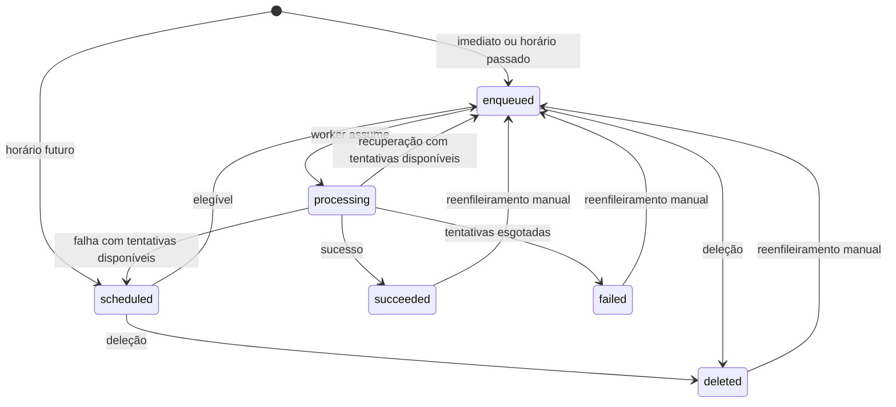

# Processamento de jobs

[Início](../README.md) · [Arquitetura](arquitetura.md)

Este documento descreve estados, workers, agendamento, retry, prontidão, recuperação e parada. Há um único processo executor por armazenamento.

## Estados e transições

Na recuperação, a tentativa aberta é fechada como `interrupted`. Se ela esgotou o limite, o estado seguinte é `failed`; caso contrário, `enqueued`, sem atraso.

Reenfileirar preserva o ID, o nome do contrato, os argumentos, as opções e os registros anteriores; incrementa o ciclo interno, zera `attempts` e devolve o job ao fim da fila. A próxima tentativa recebe número 1. A operação não atualiza a versão do contrato nem adapta argumentos para um handler mais recente.

Deletar é uma operação lógica: mantém o registro consultável e o histórico, retirando o job dos índices de trabalho pendente.

## Processamento, FIFO e agendamento

`JobServer` mantém uma tarefa coordenadora, um loop de scheduler e N loops de execução, com quantidade fixa durante sua vida. Cada loop assume um job, aguarda a função terminar e confirma sua conclusão antes de buscar outro. O parâmetro público `int workerCount = 4` vem depois de `prefix` e `timeProvider`. Valores menores que 1 são rejeitados antes do acesso ao armazenamento. A conexão pertence ao chamador.

As verificações completas precedem a primeira execução; handlers e integridade dos índices são revalidados antes da retomada de uma suspensão. Os N loops são agendados independentemente por `Task.Run`, permitindo que o trecho síncrono de uma função não impeça a instalação dos demais. A prontidão é publicada sob a mesma barreira usada na admissão e na falha fatal, depois de instalar todos os loops, se não houver pedido de parada. `StartAsync` compartilha essa inicialização entre chamadas repetidas. `StopAsync` é idempotente; uma instância parada não é reiniciada, exigindo uma nova instância para outro ciclo de serviço.

Cada worker ocioso espera 100 ms usando `TimeProvider`, com cancelamento restrito à busca de trabalho e à espera de reconexão. Uma leitura sem candidato ou reserva perdedora não autoriza invocação; a perda de uma reserva leva a nova busca, sem consumir tentativa nem acrescentar atraso de retry. `IsAvailable` combina o estado do servidor e a tarefa coordenadora; `LastError` preserva a primeira falha do episódio de suspensão ou a falha fatal, sendo limpo somente na retomada segura.

Não reservar antecipadamente jobs para uma fila local em memória. Essa decisão mantém os jobs pendentes visíveis ao gerenciamento e simplifica a parada.

Com um worker, a sequência crescente de entrada em `ready` define FIFO. Com vários workers, as reservas são exclusivas, mas não há garantia de ordem exata de início ou término das funções. O limite de N funções simultâneas decorre da quantidade de loops, cada um com uma única tentativa em andamento. A exclusividade por job decorre da reserva atômica Lua; Redis não controla a quantidade de funções executadas no processo.

O scheduler consulta o índice `scheduled` em páginas de até **128 candidatos**, limitadas pelo score do instante observado. Confere `scheduledAt <= now` com precisão de ticks; o score arredondado é apenas um filtro. Candidatos futuros na mesma faixa não escondem os elegíveis: o cursor avança pelos não removidos e reinicia após o fim da seleção. A seleção registra separadamente quantas entradas examinou e quantos candidatos reteve. Descartes reiniciam o cursor para não pular entradas deslocadas; uma página examinada completa mantém a drenagem mesmo se todos os candidatos forem descartados. Havendo progresso, continua drenando páginas; ao terminar, espera **100 ms** com `TimeProvider` e sinal de parada. Não invoca funções, não ocupa worker, não mantém fila local e não sobrepõe suas rodadas.

Um job só pode ser promovido quando seu horário de elegibilidade tiver sido atingido. Um `runAt` passado resulta diretamente em `enqueued`. Retry com atraso zero segue a transição por `scheduled`, ficando imediatamente elegível.

O objetivo é atender ao início em até dois segundos no ambiente local sem sobrecarga. Os testes HTTP com composição real verificam o intervalo de polling e a latência; não representa uma garantia de tempo real.

Usar UTC nas comparações e um `TimeProvider` injetável para testar elegibilidade e atrasos sem esperas reais em testes unitários.

## Retry e falhas

Ao finalizar a função, fechar a tentativa e persistir a próxima transição atomicamente:

| Resultado | Próximo estado |
| --- | --- |
| Função termina sem erro | `succeeded` |
| Função falha e `attempts < maxAttempts` | `scheduled` |
| Função falha e `attempts >= maxAttempts` | `failed` |

No retry, `scheduledAt = finishedAt + retryDelayMs`. O atraso é fixo e começa no fim da tentativa, não em seu início. A mensagem de erro é registrada na tentativa.

Exceções dos handlers ficam restritas às respectivas tentativas e não encerram os demais workers. Falhas de desserialização ou validação dos argumentos após a reserva também são registradas como falha daquela tentativa, com a mesma política de retry; não se cria um estado adicional ou uma política de falha imediata fora da spec. Ausência de handler é tratada na verificação de configuração antes de liberar workers, conforme [validação, manutenção e migração](contratos-e-versionamento.md#validação-manutenção-e-migração).

### Falhas de infraestrutura

Falhas de transporte classificadas (`RedisTimeoutException` e falhas de conexão de socket, resolução, conexão ou carregamento) suspendem novas admissões e retiram prontidão. Erros de servidor, autenticação, protocolo, corrupção, configuração e persistência não autorizam repetição automática. Não se interpreta timeout como prova de ausência de efeito: o comando pode continuar em trânsito. A demo usa `AbortOnConnectFail=false` e `BacklogPolicy.FailFast`, sem alterar conexões fornecidas por consumidores. A política de backlog está descrita no [código da dependência](https://github.com/StackExchange/StackExchange.Redis/blob/2.9.32/src/StackExchange.Redis/BacklogPolicy.cs).

Chamadas públicas têm política limitada: leituras podem ser repetidas uma vez; mutações consultam o recibo após falha e permitem no máximo uma retransmissão do envelope preparado. Criação reapresenta a mesma identidade e valida dados/índices. Falha persistente continua explícita: o pedido pode ter aplicado, e outra chamada pública de criação recebe outro ID. A biblioteca não recupera respostas HTTP perdidas pelo cliente.

Reserva, conclusão, promoção, recuperação e decisões manuais possuem recibos persistidos em `job:{id}:operation:{identidade}`, sem TTL. Cada recibo contém identidade, decisão, snapshot consistente após a decisão e checksum para detectar alteração de conteúdo. Reapresentação verifica o snapshot ou prova de progresso com prefixos e dados imutáveis, além dos índices; corrupção não confirma sucesso. Decisões de ausência e conflito também são retidas. Progresso comprovado sem decisão permite reler; não se trata erro de transporte como perda de disputa. Cada recibo guarda um snapshot completo para reutilizar as provas de integridade e progresso das transições. O custo acumulado é a soma desses snapshots e pode crescer quadraticamente em jobs com muitos ciclos; não há retenção automática. Registros produzidos sem recibos continuam legíveis e executáveis.

O motor mantém candidatos, tokens, datas e resultados durante as rodadas de confirmação. Uma supervisão libera rodadas de acesso a cada 500 ms via `TimeProvider`; novas admissões aguardam a resolução das operações admitidas e a revalidação dos handlers, índices e geração. Os mesmos N workers permanecem instalados. Funções ativas continuam; resultados produzidos aguardam confirmação sem reinvocação. Recuperação de `processing` pertence à inicialização de uma nova instância, nunca à reconexão de funções vivas. `LastError` preserva a primeira falha do episódio e é limpo somente após retomada segura; falha fatal ou parada sem confirmação conserva o diagnóstico.

Cada executor instala uma geração por comparação atômica com a predecessora, antes de recuperar ou executar. Escritas do motor verificam essa geração antes de qualquer efeito, inclusive ao reapresentar recibos. Um comando antigo não altera dados de uma instância sucessora. A geração não implementa coordenação entre executores simultâneos: continua obrigatório usar um executor por armazenamento. A ausência ou mudança da geração durante a retomada impede prontidão e não reconstrói silenciosamente dados perdidos.

## Inicialização e recuperação

A inicialização disponível verifica acesso ao armazenamento, percorre referências de todos os jobs em páginas de `SSCAN` e confere handlers, inclusive de finalizados. O diagnóstico identifica nomes e IDs ausentes, sem consumir tentativas. Também confere os índices e os estados persistidos nos dois sentidos: job `processing` fora do set e membro órfão são erros explícitos. Todos os resíduos válidos são recuperados antes de qualquer promoção ou worker. Registros sem ciclo usam o ciclo inicial `0`; a reserva atribui token e posição da tentativa. Resíduos em `processing` exigem token e posição válidos. Depois das verificações, o servidor promove uma página limitada de vencidos, instala o scheduler e os N loops e publica prontidão somente se não houver parada ou falha. O scheduler continua os lotes restantes sem esperar futuros vencerem. Parar durante a verificação impede a liberação dos workers e aguarda a inicialização terminar. Um handler ausente encontrado após a inicialização também impede reserva e torna o servidor indisponível.

A sequência de inicialização é:

1. Validar configuração, registros de funções e ausência de identificadores duplicados.
2. Conectar ao Redis e preparar o armazenamento e os scripts.
3. Conferir os nomes referenciados por todos os jobs persistidos, incluindo finalizados reenfileiráveis. Se faltar um registro, manter o motor indisponível, informar os jobs afetados e não avançar para recuperação ou execução.
4. Recuperar todos os jobs em `processing` antes de liberar workers.
5. Promover agendamentos vencidos.
6. Iniciar scheduler e workers.
7. Marcar o servidor como apto a processar.

Para cada job em `processing`, a recuperação fecha a tentativa aberta como `interrupted`, registra fim e motivo da interrupção, retira o job desse índice e aplica a seguinte transição:

- Move para `enqueued`, sem atraso, se houver tentativas disponíveis.
- Move para `failed` se o limite tiver sido atingido.

A recuperação é atômica por job e pode ser retomada caso outra queda aconteça durante seu andamento. Ela não apaga tentativas nem reinicia o contador ou ciclo. A seleção usa `SSCAN` não destrutivo sobre `processing`, limita/deduplica no consumidor até 128 candidatos e recomeça a varredura do conjunto restante após confirmar cada lote. `COUNT` é uma indicação, não um teto; a enumeração continua em páginas vazias com cursor não final. Referência: [SCAN/SSCAN](https://redis.io/docs/latest/commands/scan/).

Cada candidato é materializado e validado com hash, listas, ciclo, token, posição da última tentativa aberta, orçamento e índices exclusivos. `recover.lua` compara o snapshot e valida todos os tipos/parâmetros antes da primeira escrita. Com orçamento restante, valida também sequência canônica, limite `2^53 - 1` e cauda FIFO; terminais não precisam de nova posição. Uma única data UTC de `TimeProvider` fecha a tentativa e atualiza o job/histórico. Retrocesso temporal falha sem escrita.

O script fecha somente a tentativa aberta como `interrupted`, preservando número e início; remove token/posição e metadados da tentativa atual, preservando os recibos por operação, `scheduledAt` e associação a `processing`. Reenfileirados ganham nova sequência, depois dos já prontos, sem atraso de retry. O ciclo permanece inclusive no máximo de 64 bits. Resultados de uma tentativa recuperada continuam rejeitados. Um resultado já concluído pode apenas confirmar seu recibo original, sem fechar uma nova tentativa ou alterar outro ciclo.

Reapresentação exige prova de avanço com dados imutáveis, prefixos de históricos, fechamento `interrupted` da tentativa correspondente, transições/ciclo/contador e índices válidos. Não altera datas nem posição de fila. Seleção e confirmação usam a barreira de admissão: parada aguarda uma operação admitida, impede a seguinte e não publica prontidão. Falhas transitórias aguardam reconciliação; falhas permanentes encerram a instância, preservando transições confirmadas para a próxima inicialização. Não há transação global do lote.

Jobs pendentes permanecem disponíveis, e os finalizados continuam consultáveis. Os eventos em memória da demo podem ser perdidos.

A garantia é **at-least-once, sujeita ao limite de tentativas**. Uma função pode ter produzido efeitos externos antes da queda e ser executada novamente. A aplicação consumidora deve considerar idempotência desses efeitos.

## Parada graciosa

A parada segue esta ordem:

1. Fechar a admissão de novas recuperações, reservas e promoções e marcar o servidor como indisponível.
2. Interromper as esperas por trabalho.
3. Aguardar inicialização, scheduler e workers, incluindo leituras, promoções e reservas admitidas ainda sem resposta e funções em execução.
4. Confirmar suas conclusões antes de liberar recursos; falhas de confirmação mantêm diagnóstico fatal.

Recuperações, reservas, promoções e a entrada em parada usam uma barreira comum para impedir que um job pendente seja assumido durante a transição. Não há cancelamento público de funções em execução.

`JobServerHostedService` adapta o ciclo a `IHostedService`. O sinal compartilhado é descartado somente depois do término de todos os loops. O sinal de parada interrompe busca, espera ociosa e rodadas de reconexão; operações pendentes têm uma rodada final limitada de confirmação. Sem confirmação possível, o diagnóstico permanece e uma tentativa aberta pode ser recuperada e reexecutada após reinício. A parada continua aguardando funções sem limite de duração; nenhuma função recebe cancelamento. Uma reserva ou promoção admitida antes da parada, mesmo sem resposta Redis ainda, integra o trabalho aguardado. O adaptador aguarda mesmo com token do host expirado e a demo configura `HostOptions.ShutdownTimeout = Timeout.InfiniteTimeSpan`. Referência: [hosted services no ASP.NET Core](https://learn.microsoft.com/en-us/aspnet/core/fundamentals/host/hosted-services?view=aspnetcore-10.0).

Se houver encerramento forçado, a próxima inicialização recupera resíduos válidos de `processing` antes de liberar workers. A parada não cancela confirmação em andamento; resíduos não recuperados permanecem para nova instância.

## Documentação relacionada

- [Persistência Redis](persistencia-redis.md#operações-atômicas-e-concorrência): snapshots, índices e scripts das transições.
- [Contratos e versionamento](contratos-e-versionamento.md): resolução e validação dos argumentos.
- [Uso da biblioteca](uso-biblioteca.md): configuração e ciclo público do servidor.
- [Testes e validação](testes-e-validacao.md): evidências e reprodução das garantias.
